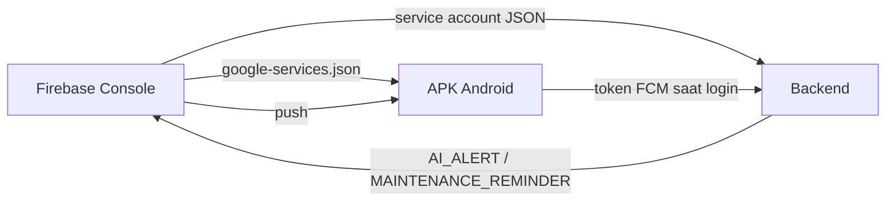

# Panduan menyiapkan Firebase Cloud Messaging

Panduan ini menjelaskan cara menyiapkan push notification dari nol: membuat proyek Firebase, memasang
kredensial di aplikasi dan server, membangun APK, lalu membuktikan bahwa notifikasi benar-benar
sampai ke perangkat. Semua nilai sensitif ditulis sebagai placeholder; isi dengan milik Anda sendiri
dan jangan pernah menyalinnya ke repository.

Push bersifat **opsional**. Tanpa Firebase, aplikasi tetap berjalan penuh dan notifikasi tetap masuk
ke pusat notifikasi di dalam aplikasi. Push hanya cermin dari baris `notifications` di database.

## 1. Bagian yang terlibat

| Bagian | Kredensial | Tempat penyimpanan | Di-commit? |
|---|---|---|---|
| Aplikasi Android | `google-services.json` | `mobile/google-services.json` | Tidak (di-ignore git) |
| Backend | Service account JSON | mis. `/etc/dc-api-firebase.json` di server | Tidak |
| Keduanya | ID proyek Firebase | hanya di dalam dua file di atas | Tidak |

Alurnya:



Aplikasi mendaftarkan token perangkat setelah login. Backend menyimpannya di tabel `device_tokens`,
lalu mengirim push **setelah** baris notifikasi in-app commit. Kegagalan pengiriman hanya dicatat di
log dan tidak menggagalkan permintaan API.

## 2. Membuat proyek Firebase dan aplikasi Android

1. Buka Firebase Console, buat proyek baru (nama bebas). Tidak perlu paket berbayar untuk kebutuhan
   FCM pada aplikasi ini.
2. Di **Project settings → Your apps**, tambahkan aplikasi Android dengan package name
   `com.datacentertracker.app` — harus sama dengan `expo.android.package` di `mobile/app.json`.
3. Unduh `google-services.json`, lalu letakkan persis di `mobile/google-services.json`.
4. Di **Project settings → Cloud Messaging**, pastikan **Firebase Cloud Messaging API (V1)** aktif.
5. Jangan commit file itu. `mobile/app.config.js` hanya menambahkan `android.googleServicesFile` bila
   file tersebut ada, sehingga build tanpa Firebase tetap berhasil dan fitur push sekadar tidak aktif.

`google-services.json` dibaca saat build, bukan saat aplikasi berjalan. Menggantinya berarti membangun
ulang APK.

## 3. Membuat service account untuk backend

1. Firebase Console → **Project settings → Service accounts → Generate new private key**.
2. Simpan file JSON hasil unduhan di server, misalnya `/etc/dc-api-firebase.json`. Jangan letakkan di
   dalam folder repository dan jangan lampirkan ke issue/chat.
3. Atur pemilik dan izin baca agar proses backend dapat membacanya. Contoh untuk service systemd
   dengan `User=dcapi` dan grup `dcapi`:

   ```bash
   sudo chown root:dcapi /etc/dc-api-firebase.json
   sudo chmod 640 /etc/dc-api-firebase.json
   ```

   `640` berarti pemilik (`root`) dan grup (`dcapi`) boleh membaca. **Mode `600` dengan pemilik
   `root` adalah penyebab paling sering** dari pesan "Push notifications disabled" walaupun
   `PUSH_ENABLED=true`: proses backend berjalan sebagai `dcapi`, tidak bisa membaca file, provider
   gagal dibuat, lalu jatuh ke mode no-op. Periksa dengan:

   ```bash
   sudo -u dcapi test -r /etc/dc-api-firebase.json && echo "bisa dibaca" || echo "tidak bisa dibaca"
   ```

4. Service account ini setara dengan kunci pengirim pesan ke seluruh perangkat di proyek Firebase.
   Perlakukan seperti password: batasi akses, jangan dicetak di log, dan putar (buat kunci baru lalu
   hapus yang lama) bila ada dugaan bocor.

## 4. Menyalakan push di backend

Tambahkan/ubah dua variabel di environment proses backend (bukan file yang di-commit):

```
PUSH_ENABLED=true
FIREBASE_SERVICE_ACCOUNT=/etc/dc-api-firebase.json
```

Lalu restart backend. Provider dibaca **sekali saat boot** oleh `initPushProvider()`; mengubah
variabel tanpa restart tidak berpengaruh.

Log yang diharapkan:

| Kondisi | Log |
|---|---|
| Berhasil | `Push notifications enabled (FCM)` |
| Nonaktif / gagal | `Push notifications disabled (PUSH_ENABLED=false or missing service account); in-app notifications only` |

Pesan kedua juga muncul bila `PUSH_ENABLED=true` tetapi path kosong, file tidak ada, atau file tidak
bisa dibaca/di-parse. Backend tidak pernah mencetak isi atau path lengkap kredensial.

Nilai default `PUSH_ENABLED=false` disengaja: tanpa service account, provider menjadi no-op dan
notifikasi in-app tetap sumber kebenaran.

## 5. Membangun APK dan mendaftarkan perangkat

Prasyarat build ada di `mobile/README.md` (JDK 17, Android SDK). Ringkasnya:

```bash
cd mobile
export EXPO_PUBLIC_API_URL=<alamat-api-yang-dapat-dijangkau-hp>
npx expo prebuild --platform android --no-install
cd android && ./gradlew assembleRelease
adb install -r app/build/outputs/apk/release/app-release.apk
```

`EXPO_PUBLIC_API_URL` harus tetap ter-export saat Gradle membundel JavaScript, bukan hanya saat
`prebuild`. APK yang dibangun tanpa `google-services.json` tetap bisa dipasang, tetapi token FCM tidak
akan pernah terbentuk.

Setelah login:

1. Dialog izin notifikasi Android muncul satu kali. Pilih **Izinkan**.
2. Aplikasi mengambil token perangkat dan mengirimnya ke `POST /api/notifications/device`.
3. Periksa database **tanpa mencetak token**:

   ```sql
   SELECT count(*) FROM device_tokens;
   SELECT platform, "lastSeenAt" FROM device_tokens ORDER BY id;
   ```

   Token tidak dikembalikan endpoint mana pun dan tidak boleh disalin ke laporan. Membuka ulang
   aplikasi tidak menambah baris (token yang sama di-upsert). Login dengan akun lain di perangkat yang
   sama memindahkan baris ke akun tersebut. Logout menghapusnya.

## 6. Membuktikan pengiriman

Lakukan dua pengujian; keduanya sudah pernah berhasil pada perangkat **Infinix X6882 (Hot 50 4G),
Android 14** dengan APK release dan backend yang memiliki service account.

### 6.1 Manual dari Firebase Console

1. Firebase Console → **Messaging** → **Send your first message** (atau **New campaign**).
2. Isi judul dan teks, pilih target aplikasi Android Anda.
3. Kirim. Notifikasi harus muncul di perangkat.
4. Ketuk notifikasi. Untuk pesan uji tanpa data khusus, aplikasi hanya membuka dirinya; routing ke
   layar tertentu memakai field `data` yang dikirim backend (lihat 6.2).

### 6.2 Jalur otomatis dari aplikasi

Backend mengirim dua jenis push:

| Jenis | Pemicu | Data routing |
|---|---|---|
| `AI_ALERT` | Prediksi risiko HIGH tersimpan (`POST /api/ai/predict/:assetId` atau batch) | `type`, `assetId`, `predictionId`, `deepLink` |
| `MAINTENANCE_REMINDER` | Pengingat baru dibuat (`POST /api/maintenance/reminders` atau job harian 07.00) | `type`, `assetId`, `maintenanceId`, `deepLink` |

Langkah:

1. Login sebagai admin di perangkat.
2. Picu `AI_ALERT`: buka tab **Risiko**, jalankan **Prediksi semua aset**, atau buka detail aset lalu
   **Prediksi ulang**. Notifikasi in-app dan push dibuat untuk prediksi HIGH.
3. Picu `MAINTENANCE_REMINDER`: buka `/schedule` dan tekan **Jalankan pengingat**, atau nyalakan job
   harian dengan `REMINDER_JOB_ENABLED=true` (berjalan 07.00 waktu server).
4. Ketuk push: `AI_ALERT` membuka detail aset, `MAINTENANCE_REMINDER` membuka detail maintenance.
   Bila catatan maintenance sudah dihapus, aplikasi membuka tab Maintenance pada aset terkait.

Push hanya dikirim untuk baris yang **baru** dibuat, sehingga menekan tombol pengingat dua kali tidak
mengirim ulang pesan yang sama.

## 7. Pemecahan masalah

| Gejala | Penyebab yang mungkin | Tindakan |
|---|---|---|
| Log "Push notifications disabled" padahal `PUSH_ENABLED=true` | File service account tidak ada, path salah, atau tidak bisa dibaca proses | Cek `sudo -u <user-proses> test -r <path>`; perbaiki kepemilikan (`root:<grup>`) dan mode `640`; restart |
| Sama seperti di atas, file ada dan mode `600` milik `root` | Proses backend bukan `root` sehingga tidak bisa membaca file | Ubah ke `root:<grup-proses> 640` atau jalankan proses sebagai pemilik file |
| Log "enabled" tetapi tidak ada pesan sampai | `google-services.json` berasal dari proyek Firebase yang berbeda dengan service account | Pastikan keduanya dari proyek yang sama; bangun ulang APK |
| Build berhasil tetapi `device_tokens` selalu kosong | APK dibangun tanpa `google-services.json`, izin notifikasi ditolak, atau aplikasi tidak dapat menjangkau API | Periksa file ada sebelum `prebuild`, izinkan notifikasi, cek `EXPO_PUBLIC_API_URL` dan konektivitas |
| FCM membalas `SENDER_ID_MISMATCH` / `403` | ID pengirim di `google-services.json` tidak cocok dengan service account | Gunakan dua file dari proyek yang sama |
| Token hilang sendiri | FCM melaporkan token tidak terdaftar/tidak valid; backend memangkasnya | Normal. Login ulang di perangkat agar token baru didaftarkan |
| Push tidak pernah masuk di iOS | APNs dan konfigurasi iOS belum disiapkan | Di luar cakupan; aplikasi saat ini hanya Android |
| API tetap 200 walau push gagal | Pengiriman bersifat fire-and-forget setelah commit | Lihat log backend; kegagalan push tidak membatalkan data |

Kode error token yang dianggap tidak valid dan dipangkas backend:
`…/registration-token-not-registered`, `…/invalid-registration-token`, dan `…/invalid-argument`.
Kegagalan sementara (mis. jaringan) tidak memangkas token.

## 8. Keamanan dan rotasi

- Jangan commit `mobile/google-services.json`, service account, ID proyek, atau path/host server.
- `google-services.json` hanya untuk build; service account hanya untuk server. Jangan menaruh
  service account di aplikasi.
- Bila salah satu file bocor: hapus kunci di Firebase Console, buat kunci baru, ganti file di server,
  restart backend, dan bangun ulang APK bila `google-services.json` ikut terekspos.
- Logout menghapus token perangkat dari database. Token yang dilaporkan FCM tidak valid juga dihapus
  otomatis.
- Batasi akses file service account ke akun proses backend saja; jangan menyalinnya ke laptop lain
  tanpa alasan.

## 9. Checklist singkat

- [ ] Proyek Firebase dibuat dan aplikasi `com.datacentertracker.app` terdaftar.
- [ ] `mobile/google-services.json` ada dan tidak di-commit.
- [ ] FCM API (V1) aktif.
- [ ] Service account ada di server, dapat dibaca proses backend (`root:<grup> 640`).
- [ ] `PUSH_ENABLED=true` dan `FIREBASE_SERVICE_ACCOUNT` menunjuk file tersebut; backend di-restart.
- [ ] Log boot berisi `Push notifications enabled (FCM)`.
- [ ] APK dibangun dengan `google-services.json` dan `EXPO_PUBLIC_API_URL` yang benar.
- [ ] Izin notifikasi diberikan; `device_tokens` berisi satu baris.
- [ ] Pesan uji dari Console sampai.
- [ ] `AI_ALERT` dan `MAINTENANCE_REMINDER` sampai dan membuka layar yang benar saat diketuk.
