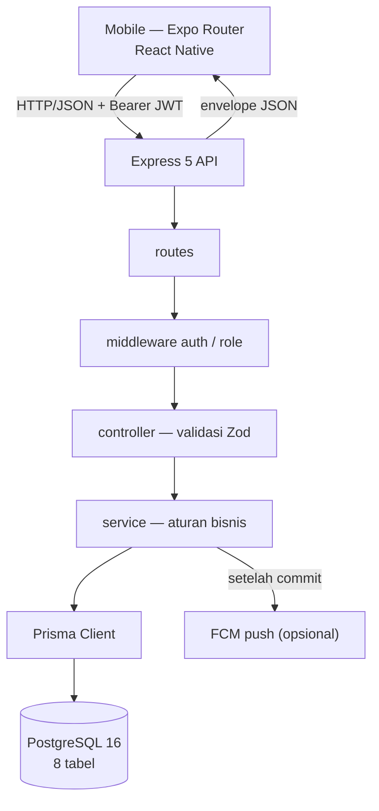

# Panduan modul per modul

Dokumen ini menjelaskan cara sistem bekerja dari dalam: peta modul backend, alur satu permintaan,
rumus mesin risiko, model data, struktur aplikasi mobile, dan alur end-to-end. Tujuannya agar pembaca
baru dapat mempelajari kode dengan urutan yang masuk akal dan tahu harus membuka file mana saat ingin
mengubah sesuatu.

Angka dan nama di dokumen ini diverifikasi langsung dari kode: **42 endpoint** (deklarasi route di
`backend/src/modules/*/*.routes.ts`), **7 modul backend**, **8 tabel + 8 enum** Prisma, **14 suite /
143 test** backend. Kontrak lengkap tiap endpoint ada di `docs/API_CONTRACT.md`.

## 1. Peta sistem



Urutan satu permintaan:

1. **Route** mencocokkan method + path. Route statis didaftarkan sebelum `/:id` agar tidak dianggap id.
2. **Middleware** `authenticate` membaca `Authorization: Bearer <token>`, memverifikasi JWT, lalu
   memuat ulang baris `users`. Akun yang dinonaktifkan langsung kehilangan akses. `requireRole('ADMIN')`
   menolak role lain dengan 403.
3. **Controller** memvalidasi `params`, `query`, dan `body` dengan skema Zod, memanggil service, lalu
   mengirim envelope. Controller tidak menyimpan aturan bisnis.
4. **Service** menjalankan aturan domain dan mengakses database lewat Prisma. Operasi yang menyentuh
   beberapa tabel dibungkus `prisma.$transaction`.
5. **Response** selalu berbentuk `{ success, message, data }` untuk sukses, dan
   `{ success, message, errors? }` untuk gagal.

Pemetaan error terpusat di `backend/src/app.ts`:

| Sumber error | Status | Contoh |
|---|---|---|
| `ZodError` | 400 | field wajib kosong, enum tidak dikenal |
| `AppError(status, message)` | sesuai | 404 aset tidak ada, 409 konflik, 403 role |
| `SyntaxError` body | 400 | JSON rusak |
| Prisma `P2002` | 409 | unique `assetCode`, `email`, `token` |
| Prisma `P2025` | 404 | baris yang diubah tidak ada |
| Prisma `P2003` | 409 | foreign key masih direferensikan |
| lainnya | 500 | dicatat ke log, pesan generik |

## 2. Modul backend

Semua modul berada di `backend/src/modules/<nama>/` dengan pola yang sama: `*.routes.ts`,
`*.controller.ts`, `*.schema.ts`, `*.service.ts`, dan `__tests__/`. Modul di-mount di
`backend/src/app.ts`.

### 2.1 Auth — `modules/auth/`

- **Tujuan:** registrasi, login, dan profil user yang sedang login.
- **File:** `auth.routes.ts`, `auth.controller.ts`, `auth.schema.ts`, `auth.service.ts`.
- **Endpoint (3):**
  | Method | Path | Akses |
  |---|---|---|
  | POST | `/api/auth/register` | publik; ADMIN hanya untuk user pertama atau dengan token ADMIN |
  | POST | `/api/auth/login` | publik |
  | GET | `/api/auth/me` | semua role |
- **Data:** `users` (username unik, email unik, `passwordHash` bcrypt, `role`, `isActive`, `lastLogin`).
- **Invarian:** `passwordHash` tidak pernah dikirim ke klien (`publicUserSelect`); login user nonaktif
  menghasilkan 403; user pertama boleh ADMIN, ADMIN berikutnya wajib membawa token ADMIN; token berlaku
  `JWT_EXPIRES_IN` (default `7d`).
- **Test:** `auth.api.test.ts`.
- **Mulai dari sini untuk mengubah:** aturan registrasi/role → `auth.service.ts`; bentuk body login →
  `auth.schema.ts`; klaim JWT → `utils/jwt.ts`.

### 2.2 Asset — `modules/asset/`

- **Tujuan:** inventaris aset, riwayat lokasi, informasi jaringan ringkas, statistik.
- **File:** `asset.routes.ts`, `asset.controller.ts`, `asset.schema.ts`, `asset.service.ts`.
- **Endpoint (6):**
  | Method | Path | Akses |
  |---|---|---|
  | GET | `/api/assets` | semua role; `search`, `type`, `status`, `rack`, `sortBy`, `order`, `page`, `limit` |
  | GET | `/api/assets/statistics` | semua role |
  | GET | `/api/assets/:id` | semua role |
  | POST | `/api/assets` | ADMIN |
  | PUT | `/api/assets/:id` | ADMIN |
  | DELETE | `/api/assets/:id` | ADMIN |
- **Data:** `assets`, `asset_locations` (1:N, hanya satu `isCurrent`), `network_information` (1:1),
  serta hitungan `maintenance_history` dan prediksi aktif untuk detail.
- **Invarian:** `assetCode` dan `serialNumber` unik (409 dengan field); update lokasi menonaktifkan
  baris lama lalu membuat baris baru sehingga riwayat tidak hilang; aset yang masih punya maintenance
  atau prediksi tidak boleh dihapus (409); statistik menghitung total, per status, per tipe, garansi
  habis ≤30 hari, dan aset baru bulan ini.
- **Test:** `asset.api.test.ts`.
- **Mulai dari sini untuk mengubah:** query list → `asset.service.ts` (`listAssets`); bentuk payload →
  `asset.schema.ts`; kolom baru → `prisma/schema.prisma` + migrasi + serializer + tipe mobile.

### 2.3 Maintenance — `modules/maintenance/`

- **Tujuan:** riwayat perawatan, sinkronisasi status aset, jadwal, dan pengingat.
- **File:** `maintenance.routes.ts`, `maintenance.controller.ts`, `maintenance.schema.ts`,
  `maintenance.service.ts`, `maintenance.reminder.job.ts`.
- **Endpoint (9):**
  | Method | Path | Akses |
  |---|---|---|
  | GET | `/api/maintenance` | semua role; filter `type`, `assetId`, `technicianId`, `startDate`, `endDate` |
  | GET | `/api/maintenance/statistics` | semua role |
  | GET | `/api/maintenance/schedule` | semua role; `window` 7/30, `includeOverdue` |
  | POST | `/api/maintenance/reminders` | ADMIN |
  | GET | `/api/maintenance/asset/:assetId` | semua role |
  | GET | `/api/maintenance/:id` | semua role |
  | POST | `/api/maintenance` | ADMIN |
  | PUT | `/api/maintenance/:id` | ADMIN |
  | DELETE | `/api/maintenance/:id` | ADMIN |
- **Data:** `maintenance_history`, `assets.status`, `notifications`.
- **Invarian status:** saat **dibuat**, hasil yang diawali `Resolved` (tanpa peduli huruf besar/kecil)
  mengembalikan aset ke `ACTIVE`; jika tidak, jenis `REPAIR`/`UPGRADE`/`REPLACEMENT` mengubah aset
  menjadi `MAINTENANCE`; `ROUTINE`/`INSPECTION` tidak mengubah status. Saat **diubah**, hanya aturan
  `Resolved` yang berlaku — mengganti jenis tidak pernah diam-diam mengembalikan status.
- **Teknisi:** bila `technicianId` tidak dikirim, dipakai user yang login. API belum punya daftar user,
  sehingga UI tidak dapat memilih teknisi lain.
- **Jadwal:** baris dengan `nextSchedule` ≤ hari ini + 30. `counts` selalu mencakup seluruh papan
  (terlewat + 30 hari) agar badge tab stabil; `items` mengikuti `window` dan `includeOverdue`.
  `state`: `OVERDUE` (<0 hari), `DUE_SOON` (≤7), `UPCOMING`.
- **Pengingat:** horizon 7 hari + terlewat, satu baris per user aktif per jadwal. `dedupeKey` berbentuk
  `<maintenanceId>:<YYYY-MM-DD>`; indeks unik `(userId, dedupeKey)` membuat eksekusi berulang
  idempoten. Hanya baris yang benar-benar disisipkan yang memicu push.
- **Job harian:** `node-cron` pola `0 7 * * *` (waktu lokal server), `noOverlap`, hanya aktif bila
  `REMINDER_JOB_ENABLED=true`.
- **Test:** `maintenance.api.test.ts`, `schedule.api.test.ts`, `reminders.test.ts`.
- **Mulai dari sini untuk mengubah:** aturan status → `resolveAssetStatus`; jendela pengingat →
  `REMINDER_HORIZON_DAYS`; isi pesan → `reminderMessage`.

### 2.4 Network — `modules/network/`

- **Tujuan:** informasi jaringan per aset dan simulasi pemeriksaan koneksi.
- **File:** `network.routes.ts`, `network.controller.ts`, `network.schema.ts`, `network.service.ts`.
- **Endpoint (8):**
  | Method | Path | Akses |
  |---|---|---|
  | GET | `/api/network` | semua role; filter `connectionStatus`, `search` hostname/IP |
  | GET | `/api/network/statistics` | semua role |
  | GET | `/api/network/asset/:assetId` | semua role |
  | GET | `/api/network/:id` | semua role |
  | POST | `/api/network` | ADMIN; upsert per `assetId` |
  | PUT | `/api/network/:id` | ADMIN |
  | DELETE | `/api/network/:id` | ADMIN |
  | POST | `/api/network/:id/check` | ADMIN |
- **Data:** `network_information` (satu baris per aset, `assetId` unik).
- **Invarian:** `POST` bersifat upsert sehingga satu aset tidak punya dua baris; `check` **tidak**
  mengirim ICMP — server mengundi `ONLINE` dengan probabilitas 0,8 dan `OFFLINE` 0,2, lalu mengisi
  `lastChecked`.
- **Test:** `network.api.test.ts`.
- **Mulai dari sini untuk mengubah:** probabilitas/aturan cek → `ONLINE_PROBABILITY` di
  `network.service.ts`; field jaringan → schema Prisma + `network.schema.ts` + tipe mobile.

### 2.5 AI Prediction — `modules/ai-prediction/`

- **Tujuan:** menghitung skor risiko deterministik, menyimpan prediksi berversi, menjelaskan
  perhitungan, dan memicu alert HIGH.
- **File (7):** `ai.routes.ts`, `ai.controller.ts`, `ai.schema.ts`, `ai.service.ts` (orkestrasi),
  `ai.statistical.ts` (lapisan 2), `ai.pattern.ts` (lapisan 3), `ai.explanation.ts` (level, faktor,
  narasi).
- **Endpoint (6):**
  | Method | Path | Akses |
  |---|---|---|
  | GET | `/api/ai/predictions` | semua role; filter `assetId`, `riskLevel`, `activeOnly` |
  | GET | `/api/ai/predictions/asset/:assetId` | semua role |
  | GET | `/api/ai/risk-summary` | semua role |
  | GET | `/api/ai/explain/:assetId` | semua role; menghitung ulang, **tidak** menyimpan |
  | POST | `/api/ai/predict/:assetId` | ADMIN |
  | POST | `/api/ai/predict-batch` | ADMIN |
- **Data:** `ai_predictions`, `assets`, `network_information`, `maintenance_history`, `notifications`.
- **Invarian:** prediksi baru menonaktifkan prediksi lama aset yang sama dalam satu transaksi
  (`isActive`); `explain` tidak menulis; level HIGH membuat satu `AI_ALERT` per user aktif; push
  dikirim setelah commit.
- **Test:** `ai.api.test.ts`, `engine-boundaries.test.ts`, `reference.test.ts`.
- **Mulai dari sini untuk mengubah:** bobot → `LAYER1_WEIGHTS`; penyesuaian statistik →
  `ai.statistical.ts`; pola → `ai.pattern.ts`; teks penjelasan → `ai.explanation.ts`.

### 2.6 Notification + push — `modules/notification/`

- **Tujuan:** pusat notifikasi per user, badge, dan pengiriman push FCM.
- **File:** `notification.routes.ts`, `notification.controller.ts`, `notification.schema.ts`,
  `notification.service.ts`, `push.provider.ts`.
- **Endpoint (9):**
  | Method | Path | Akses |
  |---|---|---|
  | GET | `/api/notifications` | semua role; hanya milik pemanggil |
  | GET | `/api/notifications/unread-count` | semua role |
  | PUT | `/api/notifications/read-all` | semua role |
  | DELETE | `/api/notifications/read` | semua role |
  | POST | `/api/notifications/device` | semua role; upsert token FCM |
  | DELETE | `/api/notifications/device` | semua role; token sendiri |
  | GET | `/api/notifications/:id` | semua role |
  | PUT | `/api/notifications/:id/read` | semua role |
  | DELETE | `/api/notifications/:id` | semua role |
- **Data:** `notifications`, `device_tokens`.
- **Invarian:** setiap baca/tulis difilter `userId`; notifikasi milik user lain dijawab 404 agar
  keberadaannya tidak bocor. Token unik per perangkat: login akun lain di perangkat yang sama
  memindahkan baris. Hapus token user lain menghasilkan `deleted: 0`.
- **Push:** provider menjadi no-op bila `PUSH_ENABLED=false`, path kosong, file tidak ada, atau file
  tidak bisa dibaca. `sendToUsers` mengirim maksimal 500 token per permintaan, memangkas token dengan
  kode `registration-token-not-registered` / `invalid-registration-token` / `invalid-argument`, dan
  tidak pernah menggagalkan request API (fire-and-forget).
- **Test:** `notification.api.test.ts`, `push.test.ts`.
- **Mulai dari sini untuk mengubah:** payload push → `dispatchPush` di pemanggil
  (`ai.service.ts`, `maintenance.service.ts`); perilaku provider → `push.provider.ts`; bentuk respons
  notifikasi → `serializeNotification`.

### 2.7 User / profil sendiri — `modules/user/`

- **Tujuan:** mengubah profil user yang sedang login.
- **File:** `user.routes.ts`, `user.controller.ts`, `user.schema.ts`, `user.service.ts`.
- **Endpoint (1):** `PATCH /api/users/me` (semua role).
- **Data:** `users`.
- **Invarian:** tidak ada `/:id`, sehingga user tidak dapat mengubah user lain. Hanya `fullName`,
  `email`, dan `password` (+ `currentPassword`) yang diterima; `username`, `role`, `isActive` ditolak
  400. Email unik mengecualikan baris pemanggil (409). Password baru di-hash bcrypt cost 10 dan wajib
  menyertakan `currentPassword` yang benar (400 bila salah). JWT yang sedang dipakai tetap sah setelah
  password berubah; mobile memilih logout.
- **Test:** `profile.api.test.ts`.
- **Mulai dari sini untuk mengubah:** field yang boleh diubah → `user.schema.ts` + `updateOwnProfile`.

### 2.8 Config dan utils

| File | Isi |
|---|---|
| `config/env.ts` | Memuat `.env` bila ada, validasi Zod semua variabel, gagal cepat saat konfigurasi salah |
| `config/database.ts` | Satu `PrismaClient` untuk proses; dipakai ulang saat `tsx watch` |
| `middlewares/auth.middleware.ts` | `authenticate`, `optionalAuthenticate`, `requireRole` |
| `utils/response.ts` | `AppError`, `sendSuccess`, `sendError`, `buildPagination` |
| `utils/jwt.ts` | Tanda tangan dan verifikasi JWT |
| `utils/password.ts` | Hash dan verifikasi bcrypt (cost 10) |
| `utils/serialize.ts` | Tanggal `YYYY-MM-DD`, Decimal ke number |
| `utils/logger.ts` | Log berlabel `[INFO]`/`[ERROR]` |
| `utils/validation.ts` | Helper validasi kecil bersama |

## 3. Mesin risiko secara rinci

Mesin ini **heuristik deterministik**: aturan berbobot, statistik riwayat, dan pencocokan pola.
Bukan model machine learning yang dilatih, tidak punya data latih, dan tidak mengklaim akurasi.

### 3.1 Lapisan 1 — aturan berbobot

Setiap faktor dinormalisasi 0–100 lalu dikalikan bobot. Total bobot 0,80 (skor maksimum teoretis 99).

| Faktor | Normalisasi | Bobot |
|---|---|---|
| `frequency` | `min(jumlah maintenance 90 hari / 5, 1) × 100` | **0,25** |
| `incidents` | `min(jumlah REPAIR 90 hari / 4, 1) × 100` | **0,20** |
| `age` | `min(usia tahun / 5, 1) × 100`; dari `purchaseDate`, fallback `createdAt` | **0,15** |
| `status` | `ACTIVE` 0, `MAINTENANCE` 100, `INACTIVE` 60 | **0,15** |
| `network` | `ONLINE` 0, `UNKNOWN` 50, `OFFLINE` 100; tanpa baris jaringan 50 | **0,05** |

### 3.2 Lapisan 2 — penyesuaian statistik (total dibatasi ±10)

| Sinyal | Aturan | Nilai |
|---|---|---|
| `zScore` | z dari interval maintenance aset terhadap peer satu tipe. Butuh ≥3 peer yang masing-masing punya ≥3 baris dan aset punya ≥2 interval. Tanda dibalik: interval lebih pendek dari peer menaikkan risiko | +10 / +5 / 0 / −5 / −10 |
| `trend` | Jumlah maintenance 45 hari terakhir dibanding 45 hari sebelumnya | naik +5, turun −5, sama 0 |
| `interval` | Rata-rata jarak maintenance terjadwal (selain `REPAIR`), butuh ≥3 baris | `<60` hari +5, `<90` +2,5, `>180` −5 |
| `peer` | Jumlah maintenance 90 hari dibanding median peer satu tipe, butuh ≥3 peer | di atas +5, di bawah −2,5 |

Penyesuaian dijumlahkan lalu di-clamp ke `[-10, 10]`. Sampel kecil sengaja menghasilkan 0 agar
lonjakan perbaikan tidak disalahartikan sebagai pola servis.

### 3.3 Lapisan 3 — pencocokan pola (maksimal +15)

| Pola | Kondisi | Boost |
|---|---|---|
| `downtimeOffline` | Jaringan `OFFLINE` | +2,5 |
| `downtimeRepair` | ≥3 `REPAIR` dalam 90 hari | +1,5 |
| `repairRatio` | `REPAIR / total maintenance 90 hari ≥ 0,5` → `min(rasio × 6,25, 5)` | 0…+5 |
| `daysSince` | Hari sejak maintenance terakhir: >90 hari naik linear, ≥180 hari penuh | 0…+5 |

### 3.4 Penggabungan dan keluaran

```
final              = clamp(layer1 + layer2 + layer3, 0, 100)   // dibulatkan 2 desimal
level              = final ≤ 30 ? LOW : final ≤ 60 ? MEDIUM : HIGH
confidence         = min(50 + min(total maintenance, 5) × 5 + (ada jaringan ? 10)
                         + (ada purchaseDate ? 10) + (usia ≥ 90 hari ? 5), 95)
predictedFailureDays = clamp(round((100 − final) × 0,9), 3, 365)
```

Contoh acuan yang diuji di `reference.test.ts` (SRV-001 pada data contoh):

- Layer 1: frekuensi 25 + insiden 20 + usia 4,5 + status 15 + jaringan 5 = **69,5**
- Layer 2: tren +5 (z-score, interval, peer 0 karena tidak ada peer) = **5**
- Layer 3: offline 2,5 + perbaikan berulang 1,5 + rasio perbaikan 5 + jarak 0 = **9**
- Total **83,5** → HIGH, confidence **95**, perkiraan **15 hari**.

`assessRisk` mengembalikan `layerBreakdown` (lapisan 1 beserta faktor, lapisan 2, lapisan 3, final)
dan `topFactors` (maksimal 5, diurutkan berdasarkan dampak absolut; minimal 3 baris diisi faktor
bernilai nol bila perlu). `layerBreakdown` **tidak** disimpan di tabel; `explain` menghitung ulang.

### 3.5 Penyimpanan dan rotasi `isActive`

`predictAsset` menjalankan transaksi: nonaktifkan semua prediksi aktif aset tersebut, buat prediksi
baru (`isActive=true`), dan bila HIGH buat notifikasi `AI_ALERT` untuk setiap user aktif yang belum
menerima alert untuk prediksi itu. Riwayat prediksi tetap ada; detail aset dan ringkasan hanya memakai
baris aktif.

### 3.6 Batch

`POST /api/ai/predict-batch` menerima `assetIds` opsional; tanpa itu seluruh aset diproses berurutan
menaik urutan id. Setiap aset punya transaksi sendiri dan dibungkus `try/catch`, sehingga satu aset
gagal tidak menghentikan sisanya. Ringkasan berisi `processed`, `high`, `medium`, `low`,
`alertsCreated`, dan `failed: [{ assetId, message }]`.

### 3.7 Alert HIGH dan push

`createHighRiskAlerts` berjalan di transaksi prediksi: satu baris per user aktif, melewati user yang
sudah punya alert untuk `predictionId` yang sama. Setelah commit, `dispatchPush` mengirim
`{ type: 'AI_ALERT', assetId, predictionId, deepLink }` ke penerima. Push tidak pernah membatalkan
prediksi atau baris notifikasi.

## 4. Model data

8 tabel dan 8 enum di `backend/prisma/schema.prisma`.

| Tabel | Isi penting | Relasi |
|---|---|---|
| `users` | `username` unik, `email` unik, `passwordHash`, `fullName`, `role`, `isActive`, `lastLogin` | 1:N aset (pembuat), maintenance (teknisi), notifikasi, device token |
| `assets` | `assetCode` unik, `serialNumber` unik opsional, tipe/status, tanggal beli/garansi | 1:N lokasi, 1:1 jaringan, 1:N maintenance, 1:N prediksi, 1:N notifikasi |
| `asset_locations` | `dataCenter`, `rack`, `rackSlot`, `floor`, `room`, `isCurrent`, `movedAt` | N:1 aset, cascade |
| `network_information` | `assetId` unik, hostname/IP/subnet/gateway/MAC, status, `lastChecked` | 1:1 aset, cascade |
| `maintenance_history` | jenis, tanggal, uraian, hasil, biaya, `nextSchedule` | N:1 aset (`Restrict`), N:1 teknisi (`SetNull`) |
| `ai_predictions` | skor, level, confidence, `topFactors` JSON, rekomendasi, perkiraan hari, versi, `isActive` | N:1 aset, cascade; 1:N notifikasi |
| `notifications` | tipe, judul, pesan, `isRead`/`readAt`, `dedupeKey` | N:1 user cascade; aset/prediksi/maintenance `SetNull` |
| `device_tokens` | `token` unik, `platform`, `lastSeenAt` | N:1 user cascade |

Enum: `Role` (ADMIN, TECHNICIAN), `AssetType` (SERVER, SWITCH, ROUTER, STORAGE, FIREWALL, RACK,
OTHER), `AssetStatus` (ACTIVE, MAINTENANCE, INACTIVE), `ConnectionStatus` (ONLINE, OFFLINE, UNKNOWN),
`MaintenanceType` (ROUTINE, REPAIR, UPGRADE, INSPECTION, REPLACEMENT), `RiskLevel` (LOW, MEDIUM, HIGH),
`NotificationType` (AI_ALERT, MAINTENANCE_REMINDER, SYSTEM, INFO), `DevicePlatform` (ANDROID, IOS).

Beberapa keputusan penting:

- **Riwayat lokasi** tidak di-update di tempat: baris lama menjadi `isCurrent=false`, baris baru dibuat.
- **`onDelete: Restrict`** pada maintenance membuat aset yang punya riwayat tidak bisa dihapus; service
  juga menolak aset yang punya prediksi (409).
- **`dedupeKey`** hanya dipakai pengingat buatan sistem; `NULL` untuk notifikasi lain. PostgreSQL
  menganggap setiap `NULL` berbeda, sehingga notifikasi manual tidak saling bentrok. Menghapus
  notifikasi membebaskan kuncinya, jadi pemindaian berikutnya dapat membuat ulang pengingat.
- **`ai_predictions.isActive`** menandai prediksi terbaru; baris lama tetap tersimpan sebagai riwayat.

### Migrasi dan seed

Migrasi yang ada (3): `20261030182909_init`, `20261104090000_add_maintenance_reminders`,
`20261104120000_add_device_tokens`.

```bash
cd backend
npx prisma migrate dev        # lokal: buat/terapkan migrasi + generate client
npx prisma migrate deploy     # database yang sudah ada/test: terapkan tanpa reset
npx prisma generate           # setelah mengubah schema
npm run prisma:seed           # 2 user, 9 aset, 8 maintenance, 8 baris jaringan
```

Seed memakai `upsert` untuk user dan aset, melewati maintenance yang kombinasinya sudah ada, dan
membutuhkan `SEED_ADMIN_PASSWORD` + `SEED_TECH_PASSWORD`. Seed tidak membuat prediksi atau notifikasi;
jalankan prediksi batch sekali bila dashboard perlu terisi. Database test dibuat oleh
`npm run test:db:prepare` dari `DATABASE_URL` dengan nama diganti `datacenter_tracker_test`; script
memakai `migrate deploy`, bukan reset.

## 5. Aplikasi mobile

Expo Router dengan root di `mobile/src/app`. Semua teks berbahasa Indonesia.

### 5.1 Peta route

| Route | Layar | Akses | Catatan |
|---|---|---|---|
| `/(auth)/login` | Login | publik | Menampilkan alamat API aktif, error inline |
| `/(tabs)` | Dashboard | login | Statistik, risiko, jadwal, akses cepat |
| `/(tabs)/assets` | Daftar aset | login | Cari (debounce 400 ms), filter, pagination 6 |
| `/(tabs)/ai` | Risiko | login | Ringkasan, top 5, explain, prediksi batch (admin) |
| `/(tabs)/notifications` | Notifikasi | login | Badge, tandai baca, hapus, routing |
| `/(tabs)/profile` | Profil | login | Edit profil, logout |
| `/asset/[id]` | Detail aset | login | Tab Umum/Jaringan/Maintenance/Risiko |
| `/asset/new` | Tambah aset | ADMIN | Form Umum + Lokasi + Jaringan |
| `/asset/[id]/edit` | Ubah aset | ADMIN | Prefill dari detail |
| `/maintenance` | Daftar maintenance | login | Filter jenis, pagination |
| `/maintenance/[id]` | Detail maintenance | login | Tanggal, teknisi, biaya, hasil |
| `/maintenance/new` | Catat maintenance | ADMIN | Pemilih aset, aturan status |
| `/schedule` | Jadwal maintenance | login | Tab Terlewat/7/30 hari; pengingat (admin) |
| `/network` | Jaringan | login | Status, cari, cek (admin) |

### 5.2 Auth store dan jembatan sesi

- `src/store/auth.ts` — Zustand + `persist` ke AsyncStorage (kunci `datacenter-tracker-auth`).
  Menyimpan `token` dan `user`; `login()` memanggil API, `logout()` menghapus token perangkat lalu
  membersihkan sesi, `updateUser()` mengganti profil setelah edit.
- `src/api/session.ts` — jembatan tanpa siklus impor: menyimpan token untuk client HTTP dan handler
  401. Store dan root layout mendorong nilainya; `api/client.ts` tidak mengimpor store.
- `src/app/_layout.tsx` — memuat font, menahan splash sampai font + sesi siap, mendaftarkan handler
  401 (logout + redirect ke login), mendaftarkan token push, dan menangani ketukan notifikasi.

### 5.3 API client dan penanganan 401

`src/api/client.ts`:

- `API_URL = process.env.EXPO_PUBLIC_API_URL ?? 'http://localhost:3000'`.
- Interceptor request menambahkan `Authorization: Bearer <token>`.
- Interceptor response: 401 pada selain login dan masih milik sesi aktif memicu `notifyUnauthorized()`
  (logout + redirect). Ini mencegah respons 401 dari request lama menghapus sesi baru.
- `extractErrorMessage` mengubah error menjadi satu kalimat; tanpa respons menjadi petunjuk koneksi.
- `describeAssetError` memetakan 409 aset ke pesan Indonesia (kode, serial, masih punya riwayat).

### 5.4 Desain dan komponen

- `src/theme/colors.ts` — palet; varian `successInk`/`warningInk`/`dangerInk` aman untuk teks.
- `src/theme/spacing.ts` — skala 4–40, radius 12/16/20/28.
- `src/theme/typography.ts` — Plus Jakarta Sans 400/500/600/700/800 per bobot.
- `src/theme/tokens.ts` — elevasi, gradien, durasi motion, warna grafik.
- Komponen utama: `GradientHeader`, `ChartCard`, `DataList`, `StatusPill`, `Chip`, `SegmentedTabs`,
  `DonutChart`, `BarChart`, `RiskGauge`, `Skeleton`, `EmptyState`, `Sheet`, `Toast`, `ConfirmDialog`,
  `FormField`, `AssetForm`.
- Grafik hanya memakai angka dari API (`/api/assets/statistics`, `/api/ai/risk-summary`).

### 5.5 Peta layar ke endpoint

| Layar | Endpoint |
|---|---|
| Login | `POST /api/auth/login` |
| Tab shell (badge) | `GET /api/notifications/unread-count` |
| Dashboard | `GET /api/assets/statistics`, `GET /api/ai/risk-summary`, `GET /api/maintenance/schedule` |
| Daftar aset | `GET /api/assets` |
| Detail aset | `GET /api/assets/:id`, `GET /api/maintenance/asset/:assetId`, `GET /api/ai/explain/:assetId`, `POST /api/ai/predict/:assetId` (admin) |
| Tambah / ubah / hapus aset | `POST /api/assets`, `PUT /api/assets/:id`, `DELETE /api/assets/:id` |
| Daftar maintenance | `GET /api/maintenance` |
| Detail maintenance | `GET /api/maintenance/:id` |
| Catat maintenance | `POST /api/maintenance`, `GET /api/assets` (pemilih) |
| Jadwal | `GET /api/maintenance/schedule`, `POST /api/maintenance/reminders` (admin) |
| Jaringan | `GET /api/network`, `POST /api/network/:id/check` (admin) |
| Tab Risiko | `GET /api/ai/risk-summary`, `GET /api/ai/explain/:assetId`, `POST /api/ai/predict-batch` (admin) |
| Notifikasi | `GET /api/notifications`, `GET /api/notifications/unread-count`, `PUT /api/notifications/:id/read`, `PUT /api/notifications/read-all`, `DELETE /api/notifications/:id`, `DELETE /api/notifications/read` |
| Profil | `PATCH /api/users/me` |
| Sesi push | `POST /api/notifications/device`, `DELETE /api/notifications/device` |

### 5.6 Push di mobile

- `src/notifications/push.ts` mengatur handler foreground, channel Android `default` (importance
  HIGH), izin, token perangkat, dan pembersihan saat logout.
- Setelah login/auto-login (`_layout` memantau `token`), `registerPushToken()` meminta izin,
  mengambil `getDevicePushTokenAsync()`, lalu `POST /api/notifications/device`. Token yang berputar
  didaftarkan ulang lewat listener.
- Logout memanggil `DELETE /api/notifications/device` sebelum sesi dibersihkan, lalu
  `unregisterForNotificationsAsync()`. Operasi diserialkan agar registrasi yang terlambat tidak
  membuat ulang baris.
- Routing ketukan: `MAINTENANCE_REMINDER` + `maintenanceId` → `/maintenance/:id`; selain itu
  `assetId` → `/asset/:id`. Tanpa sesi, ketukan diabaikan. Ketukan saat aplikasi tertutup dibaca
  dari `getLastNotificationResponseAsync` setelah font + sesi siap.
- Tanpa `google-services.json`, semua kegagalan ditelan dan aplikasi tetap berjalan.

### 5.7 Varian build

| Varian | JavaScript | Butuh Metro? | Catatan |
|---|---|---|---|
| Release | Ditaman di APK | Tidak | Default untuk uji di HP |
| Debug | Dibaca dari Metro | Ya (`adb reverse tcp:8081`) | Untuk pengembangan |

Keduanya ditandatangani debug keystore (bukan untuk toko aplikasi). `android/` hasil `expo prebuild`
di-ignore. `EXPO_PUBLIC_API_URL` dibaca saat Gradle membundel JavaScript, jadi mengganti alamat berarti
build ulang; detail perintah ada di `mobile/README.md`.

## 6. Alur end-to-end

1. **Login** — `login.tsx` → `POST /api/auth/login` → `auth.service.loginUser` memverifikasi bcrypt,
   memperbarui `lastLogin`, menandatangani JWT. Store menyimpan token + user; `_layout` mendaftarkan
   token push.
2. **Dashboard** — `(tabs)/index.tsx` memanggil statistik aset, ringkasan risiko, dan jadwal secara
   paralel; kartu risiko tinggi membuka `/asset/:id`.
3. **Tambah aset** — `asset/new.tsx` → `POST /api/assets` → `asset.service.createAsset` memeriksa
   keunikan, membuat aset + lokasi `isCurrent` + jaringan dalam satu operasi.
4. **Catat maintenance** — `maintenance/new.tsx` → `POST /api/maintenance` →
   `resolveAssetStatus`: `REPAIR`/`UPGRADE`/`REPLACEMENT` tanpa `Resolved` membuat aset `MAINTENANCE`;
   hasil berawalan `Resolved` membuatnya `ACTIVE`.
5. **Prediksi** — admin menekan **Prediksi ulang** atau **Prediksi semua aset** →
   `ai.service.predictAsset` / `predictBatch` menghitung tiga lapisan, menonaktifkan prediksi lama,
   menyimpan yang baru.
6. **Alert HIGH** — dalam transaksi yang sama, `createHighRiskAlerts` membuat `AI_ALERT` untuk setiap
   user aktif; setelah commit `dispatchPush` mengirim ke perangkat.
7. **Pengingat maintenance** — `POST /api/maintenance/reminders` atau job 07.00 memindai jadwal
   terlewat/≤7 hari, menyisipkan `MAINTENANCE_REMINDER` dengan `dedupeKey`, dan hanya mengirim push
   untuk baris baru.
8. **Push dan routing** — `push.provider.ts` mengirim payload; `_layout.openNotificationTarget`
   membuka detail aset atau detail maintenance.
9. **Edit profil** — `(tabs)/profile.tsx` → `PATCH /api/users/me` → `updateOwnProfile` memvalidasi
   email/password, meng-hash password baru, mengembalikan user; store mengganti profil sehingga
   sapaan/avatar langsung berubah.

## 7. Cara belajar dan menguji

### Perintah

```bash
# Backend
cd backend
npm install
npx prisma generate
npm run typecheck
npm run test:db:prepare     # buat + migrasi + kosongkan datacenter_tracker_test
npm run test:coverage       # 14 suite / 143 test + threshold
npm run test:db:drop
npm run dev

# Mobile
cd mobile
npm install
npm run typecheck
EXPO_PUBLIC_API_URL=http://<IP-LAN-komputer>:3000 npx expo start --android
```

Coverage terakhir: statements 89,75%, lines 89,72%, functions 94,19%, branches 73,56% (threshold
70/70/70/60 di `jest.config.mjs`). Suite berjalan serial (`maxWorkers: 1`) karena berbagi database test.

### Checklist menambah endpoint

1. Tambah field/enum di `prisma/schema.prisma` bila perlu, lalu migrasi + `prisma generate`.
2. Buat skema Zod di `modules/<modul>/<modul>.schema.ts`.
3. Tambah fungsi service (aturan bisnis) dan controller tipis.
4. Daftarkan route di `*.routes.ts`; letakkan path statis sebelum `/:id`.
5. Pastikan modul sudah di-mount di `app.ts` (semua modul yang ada sudah).
6. Tambah test HTTP di `__tests__` (sukses, 400, 401, 403, 404, 409 bila relevan).
7. Perbarui `docs/API_CONTRACT.md` dan tipe di `mobile/src/types/api.ts`.
8. Tambah fungsi di `mobile/src/api/` dan pakai dari layar; jalankan `npx tsc --noEmit`.
9. Uji di perangkat atau web, lalu perbarui README bila perilaku pengguna berubah.

### Checklist menambah layar

1. Buat file route di `src/app/`; daftarkan di tab layout bila layar utama.
2. Tambah fungsi API di `src/api/`; jangan memanggil axios langsung dari layar.
3. Gunakan `useIsAdmin()` untuk kontrol tulis; backend tetap menegakkan role.
4. Pakai token/komponen yang ada (`ChartCard`, `ScreenHeader`, `StatusPill`, `FormField`, dst.).
5. Tangani loading, error, empty state, dan pull-to-refresh seperti layar lain.
6. Uji di HP fisik (bukan emulator) dan periksa `npx tsc --noEmit`.

### Kegagalan yang sering muncul

| Gejala | Penyebab | Perbaikan |
|---|---|---|
| 401 di semua layar | token kedaluwarsa, `JWT_SECRET` berubah, akun dinonaktifkan | login ulang; pastikan secret stabil |
| 403 saat menyimpan | memakai akun TECHNICIAN | login sebagai ADMIN; role dicek di route |
| 409 saat membuat aset | `assetCode`/`serialNumber` sudah dipakai | pakai nilai unik; pesan field ada di respons |
| 409 saat menghapus aset | masih ada maintenance/prediksi | hapus riwayat lebih dulu atau nonaktifkan aset |
| Prisma error saat mulai | migrasi belum diterapkan | `npx prisma migrate deploy` lalu `npx prisma generate` |
| Test gagal "database does not exist" | database test belum dibuat | `npm run test:db:prepare` |
| Push tidak terkirim | provider no-op | cek log boot dan `PUSH_ENABLED`/`FIREBASE_SERVICE_ACCOUNT` |
| Aplikasi memanggil alamat salah | `EXPO_PUBLIC_API_URL` tidak ter-export saat build | build ulang dengan variabel yang benar |
| Data test mengubah data demo | memakai database yang salah | test hanya boleh memakai `datacenter_tracker_test` |
| Skor berubah setelah uji manual | skor dihitung dari data aktual | reset data demo atau prediksi ulang |

## 8. Indeks file

### Backend (`backend/src/`)

| Path | Fungsi |
|---|---|
| `app.ts` | Merakit middleware, route, health check, dan penanganan error |
| `server.ts` | Boot: koneksi database, provider push, HTTP server, job pengingat, shutdown |
| `config/env.ts` | Validasi variabel lingkungan dengan Zod |
| `config/database.ts` | Singleton Prisma Client |
| `middlewares/auth.middleware.ts` | Autentikasi Bearer dan guard role |
| `modules/auth/auth.routes.ts` | Route register/login/me |
| `modules/auth/auth.controller.ts` | Validasi input dan pengiriman respons auth |
| `modules/auth/auth.schema.ts` | Skema Zod registrasi dan login |
| `modules/auth/auth.service.ts` | Aturan registrasi admin, login, profil publik |
| `modules/asset/asset.routes.ts` | Route CRUD dan statistik aset |
| `modules/asset/asset.controller.ts` | Handler HTTP aset |
| `modules/asset/asset.schema.ts` | Skema query/body aset |
| `modules/asset/asset.service.ts` | Query, transaksi lokasi/jaringan, aturan hapus |
| `modules/maintenance/maintenance.routes.ts` | Route maintenance, jadwal, pengingat |
| `modules/maintenance/maintenance.controller.ts` | Handler HTTP maintenance |
| `modules/maintenance/maintenance.schema.ts` | Skema maintenance, jadwal, pengingat |
| `modules/maintenance/maintenance.service.ts` | Aturan status, jadwal, fan-out pengingat |
| `modules/maintenance/maintenance.reminder.job.ts` | Job cron harian 07.00 |
| `modules/network/network.routes.ts` | Route informasi jaringan |
| `modules/network/network.controller.ts` | Handler HTTP jaringan |
| `modules/network/network.schema.ts` | Skema jaringan |
| `modules/network/network.service.ts` | Upsert, simulasi cek, statistik |
| `modules/ai-prediction/ai.routes.ts` | Route prediksi dan ringkasan |
| `modules/ai-prediction/ai.controller.ts` | Handler HTTP AI |
| `modules/ai-prediction/ai.schema.ts` | Tipe input dan kontrak keluaran AI |
| `modules/ai-prediction/ai.service.ts` | Orkestrasi skor, penyimpanan, alert, batch |
| `modules/ai-prediction/ai.statistical.ts` | Lapisan 2 dan helper statistik |
| `modules/ai-prediction/ai.pattern.ts` | Lapisan 3 pencocokan pola |
| `modules/ai-prediction/ai.explanation.ts` | Level risiko, faktor dominan, narasi |
| `modules/notification/notification.routes.ts` | Route notifikasi dan perangkat |
| `modules/notification/notification.controller.ts` | Handler HTTP notifikasi |
| `modules/notification/notification.schema.ts` | Skema daftar dan token perangkat |
| `modules/notification/notification.service.ts` | Scoping per user, badge, alert HIGH, token |
| `modules/notification/push.provider.ts` | Provider FCM/no-op, chunking, pemangkasan token |
| `modules/user/user.routes.ts` | Route `PATCH /me` |
| `modules/user/user.controller.ts` | Handler HTTP profil |
| `modules/user/user.schema.ts` | Skema field profil yang boleh diubah |
| `modules/user/user.service.ts` | Update profil, konflik email, ganti password |
| `utils/response.ts` | AppError, envelope, pagination |
| `utils/jwt.ts` | Tanda tangan/verifikasi token |
| `utils/password.ts` | Hash/verifikasi bcrypt |
| `utils/serialize.ts` | Serialisasi tanggal dan Decimal |
| `utils/logger.ts` | Log terformat |
| `utils/validation.ts` | Helper validasi bersama |

### Mobile (`mobile/src/`)

| Path | Fungsi |
|---|---|
| `app/_layout.tsx` | Root: font, splash, handler 401, registrasi push, routing ketukan |
| `app/index.tsx` | Redirect sesuai status sesi |
| `app/(auth)/login.tsx` | Form login dan error inline |
| `app/(tabs)/_layout.tsx` | Lima tab, badge notifikasi, redirect tanpa sesi |
| `app/(tabs)/index.tsx` | Dashboard |
| `app/(tabs)/assets.tsx` | Daftar, cari, filter, pagination |
| `app/(tabs)/ai.tsx` | Ringkasan risiko, top 5, explain, batch |
| `app/(tabs)/notifications.tsx` | Pusat notifikasi dan aksi baca/hapus |
| `app/(tabs)/profile.tsx` | Profil, edit profil, logout |
| `app/asset/` | Detail, tambah, ubah aset |
| `app/maintenance.tsx`, `app/maintenance/` | Daftar, detail, catat maintenance |
| `app/schedule.tsx` | Jadwal dan tombol pengingat |
| `app/network.tsx` | Daftar jaringan dan aksi cek |
| `api/client.ts` | Axios, bearer, 401, pesan error |
| `api/session.ts` | Jembatan token/handler 401 |
| `api/*.ts` | Pembungkus endpoint per domain |
| `notifications/push.ts` | Izin, channel, token, pembersihan, refresh |
| `store/auth.ts` | Sesi Zustand + AsyncStorage |
| `store/notifications.ts` | Jumlah belum dibaca untuk badge |
| `hooks/` | `useIsAdmin`, `useReducedMotion`, `useCountUp` |
| `theme/` | Warna, spacing, tipografi, token desain |
| `components/` | Primitif UI dan grafik SVG |
| `types/api.ts` | Tipe respons API |
| `utils/` | Format tanggal/angka/waktu, label status |
